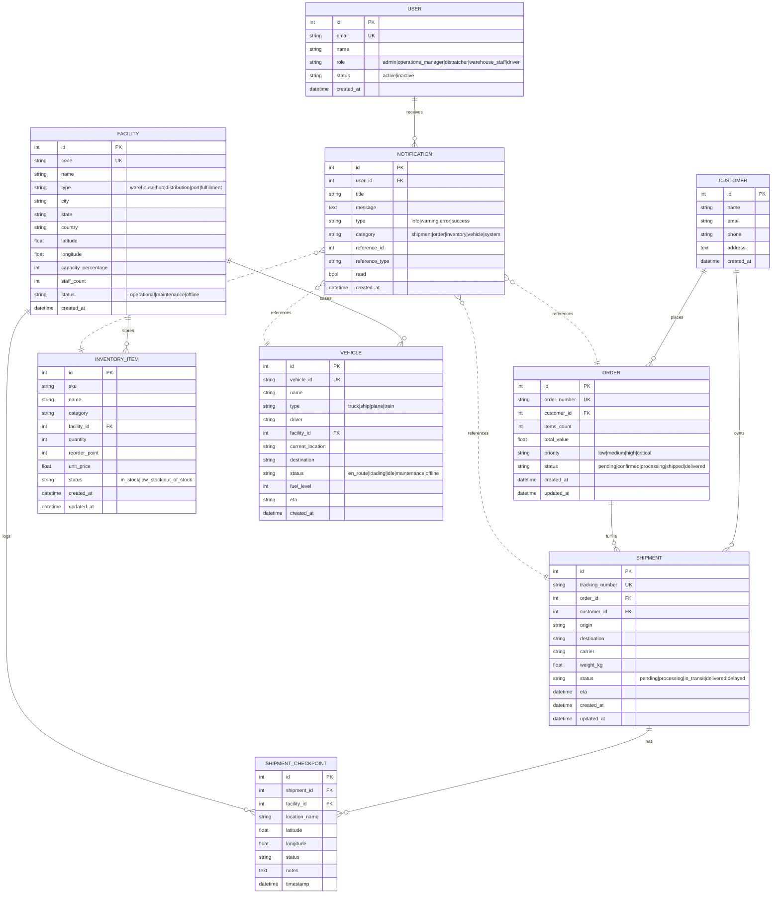

# Data Model

The persistence layer is a single SQLite database (`backend/acme_logistics.db`)
managed by SQLAlchemy 2.0 ORM models in
[`backend/app/models/models.py`](../../backend/app/models/models.py). This
document captures the entity relationships and common access patterns so AI
agents can reason about schema changes without grepping every route.

## Entity-Relationship Diagram

Notes:

- `NOTIFICATION.reference_id` / `reference_type` form a soft polymorphic
  association rather than a foreign key. Integrity is enforced by the services
  that create notifications (for example
  `backend/app/services/inventory_alerts.py`).
- `SHIPMENT.order_id` is nullable: shipments can exist before an order is
  linked (e.g. inbound freight), but once attached they cascade status updates
  into the order.

## Table Summary

| Table | Primary Key | Unique Indexes | Key Indexes |
|-------|-------------|----------------|-------------|
| `customers` | `id` | — | `name` |
| `facilities` | `id` | `code` | `code` |
| `orders` | `id` | `order_number` | `order_number`, `customer_id` |
| `shipments` | `id` | `tracking_number` | `tracking_number`, `customer_id`, `order_id` |
| `shipment_checkpoints` | `id` | — | `shipment_id` |
| `inventory_items` | `id` | — | `sku`, `facility_id` |
| `vehicles` | `id` | `vehicle_id` | `vehicle_id`, `facility_id` |
| `users` | `id` | `email` | `email` |
| `notifications` | `id` | — | `user_id`, `reference_id` |

## Lifecycle & Invariants

- Order status transitions typically follow:
  `pending -> confirmed -> processing -> shipped -> delivered`.
- Shipment status transitions typically follow:
  `pending -> processing -> in_transit -> delivered` (with a `delayed`
  side-state). Each transition appends a `shipment_checkpoints` row recorded
  by the shipment routes and broadcast via `ws_manager.broadcast_status_update`.
- Inventory status mirrors quantity vs. `reorder_point`:
  - `quantity == 0` -> `out_of_stock` and an `error` notification is emitted.
  - `quantity <= reorder_point` -> `low_stock` and a `warning` notification.
  - When quantity rises above the reorder point, any unread low-stock
    notifications are marked read by
    `sync_low_stock_notification` in `backend/app/services/inventory_alerts.py`.

## Query Patterns

The routes in `backend/app/api/v1/routes/` rely on a small set of query shapes:

- Eager-load related collections with `joinedload` to avoid N+1 (for example
  `InventoryItem.facility` in `main.run_inventory_scan_once`).
- Filter + paginate using query parameters translated to SQLAlchemy `.filter()`
  clauses.
- Soft polymorphic joins for notifications use
  `reference_type + reference_id` rather than real foreign keys.

## Migrations

The project currently relies on `Base.metadata.create_all(bind=engine)` at
startup to materialize tables. When schema changes become non-additive
(column drops, type changes), introduce Alembic migrations before shipping.

## Seeding

Demo data is generated by [`backend/seed.py`](../../backend/seed.py). The
`pnpm seed` and `pnpm db:reset` scripts are the supported way to reset local
state; avoid hand-editing the SQLite file.
