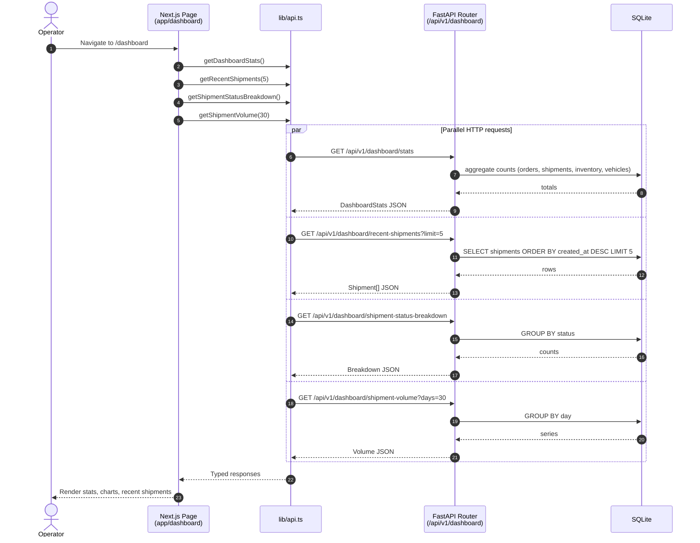
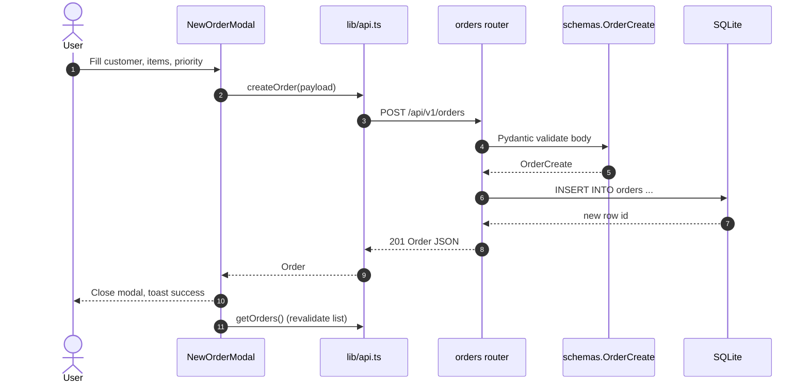
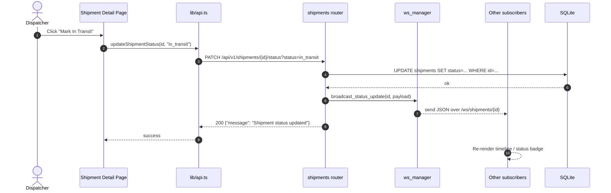
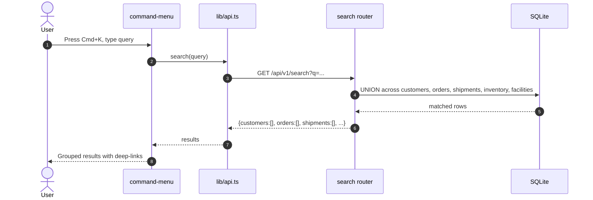
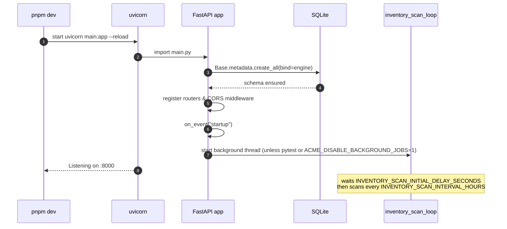
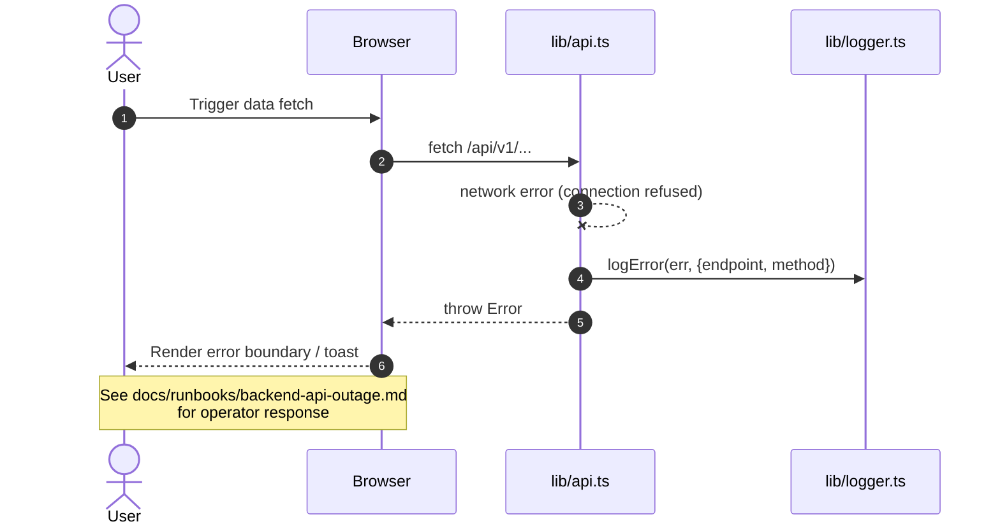

# Request Flows

Sequence diagrams for the most important user and system flows in the Acme
Logistics platform. Use these as the authoritative reference when tracing how a
feature works end-to-end.

## 1. Loading the Dashboard

When an operator opens `/dashboard`, the Next.js page makes parallel requests to
the FastAPI backend through the typed client in `frontend/lib/api.ts`.



## 2. Creating an Order

Triggered from the `new-order-modal` component or the command palette
(`Cmd+K`).



If validation fails, the backend returns `422 Unprocessable Entity` with a
field-level error list that the UI surfaces via the shared toast/alert
component.

## 3. Updating Shipment Status (WebSocket Broadcast)

The status update path powers real-time tracking on the shipment detail page.



Subscribers connect to `ws://localhost:8000/ws/shipments/{shipment_id}` via the
`use-shipment-socket` hook. The connection is maintained by
`backend/app/ws/manager.py::ConnectionManager`, which is an in-process registry;
horizontal scaling would require replacing it with Redis pub/sub or similar.

## 4. Low-Stock Alert Lifecycle

Combines a synchronous path (inventory mutation routes) with an asynchronous
background scan.

```mermaid
sequenceDiagram
    autonumber
    participant Loop as inventory_scan_loop<br/>(background thread)
    participant Svc as services.inventory_alerts
    participant DB as SQLite
    participant Bell as Notifications API
    participant UI as Header bell / notifications page

    Note over Loop: Runs every<br/>INVENTORY_SCAN_INTERVAL_HOURS
    Loop->>DB: SELECT inventory_items JOIN facilities
    DB-->>Loop: items[]
    loop For each item
        Loop->>Svc: sync_low_stock_notification(db, item)
        alt item below reorder_point AND no unread notification
            Svc->>DB: INSERT notification (warning/error)
        else item above reorder_point AND unread notifications exist
            Svc->>DB: UPDATE notifications SET read=1
        else no change needed
            Svc-->>Loop: None
        end
    end
    Loop->>DB: commit()

    UI->>Bell: GET /api/v1/notifications/unread-count
    Bell->>DB: SELECT COUNT(*) WHERE read=0
    DB-->>Bell: n
    Bell-->>UI: {unread_count: n}
```

Inventory mutation routes (create/update/adjust) also call
`sync_low_stock_notification` inline so notifications are emitted immediately
without waiting for the next scheduled scan.

## 5. Global Search (Cmd+K)



## 6. Application Startup



## 7. Error Path: Backend Unreachable



---

When adding new user-visible flows, append a section to this document and
cross-link the relevant runbook under `docs/runbooks/` if there are known
operational failure modes.
