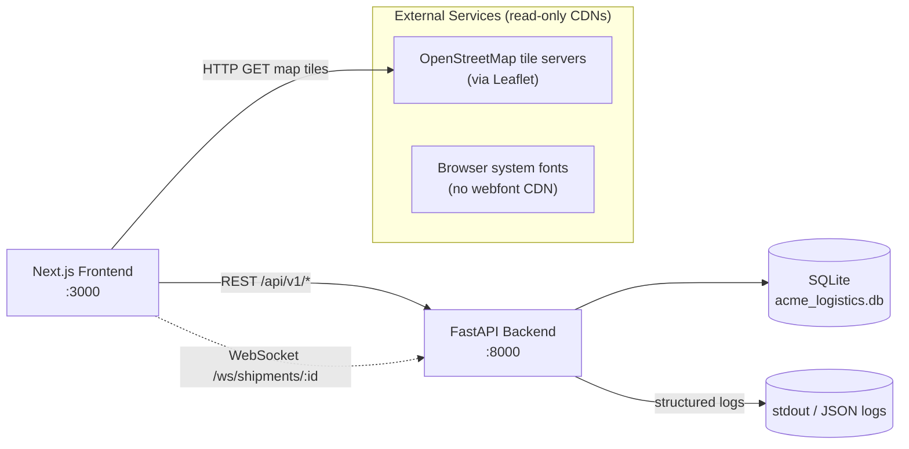
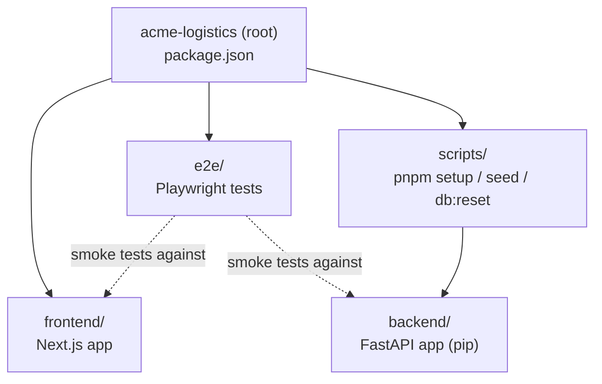
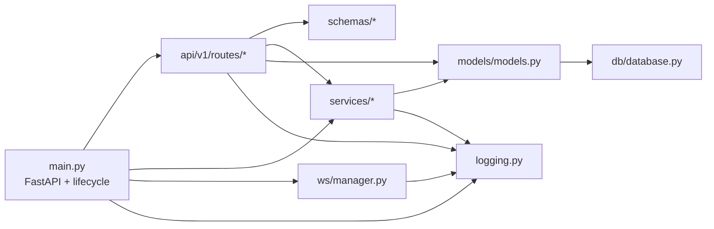
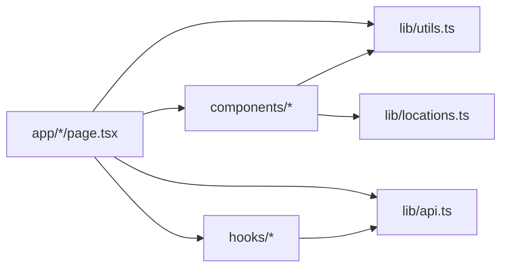

# Service Dependencies

This document enumerates every external service, third-party API, database, and
significant internal dependency the Acme Logistics platform relies on at
runtime. It is intended to help AI agents and new engineers reason about the
blast radius of a change and to support incident response (see
[`docs/runbooks/`](../runbooks/README.md)).

## Runtime Dependency Graph

The platform is intentionally self-contained: the backend has **no outbound
calls** to third-party APIs, and the database is an embedded SQLite file. The
only external runtime dependency from the browser is the tile server used by
Leaflet maps on facility and fleet pages.

## Inbound Surfaces

| Surface | URL / Protocol | Consumer |
|---------|----------------|----------|
| REST API | `http://localhost:8000/api/v1/*` | Next.js frontend, external integrators |
| WebSocket | `ws://localhost:8000/ws/shipments/{id}` | Next.js `use-shipment-socket` hook |
| Health check | `GET /health` | CI / uptime monitors |
| OpenAPI schema | `GET /openapi.json` and `GET /docs` | Tooling / documentation |

## Outbound / External Services

| Dependency | Used By | Purpose | Failure Mode |
|------------|---------|---------|--------------|
| OpenStreetMap tiles | `frontend/components/*-map*`, Leaflet | Base tiles for shipment/facility/fleet maps | Maps render blank; app still usable |
| None (backend) | — | The FastAPI service intentionally makes no external HTTP calls | — |

When adding new outbound integrations (payments, email, SMS, tracking APIs,
etc.), update this table and add a corresponding runbook entry.

## Data Stores

| Store | Type | Location | Owner |
|-------|------|----------|-------|
| Primary database | SQLite | `backend/acme_logistics.db` | Backend (SQLAlchemy) |
| SQLAlchemy metadata | In-memory registry | `backend/app/db/database.py::Base` | Backend |

See [Data Model](./data-model.md) for the schema and [Database Issues runbook](../runbooks/database-issues.md)
for recovery procedures.

## Internal Package Dependencies

The monorepo is managed by pnpm workspaces (`pnpm-workspace.yaml`). The
following graph shows how the workspace packages depend on each other:

Python dependencies for the backend live in `backend/requirements.txt` and
`backend/pyproject.toml`. Node dependencies are unified by Syncpack
(`.syncpackrc.json`).

## Backend Module Dependencies

Key module roles:

- `backend/main.py` wires routers, middleware, the WebSocket endpoint, and
  launches the inventory scan background thread.
- `backend/app/api/v1/routes/` contains one router per domain. Routers depend on
  `schemas` for I/O validation, `models` for ORM access, and occasionally on
  `services` for cross-cutting logic.
- `backend/app/services/inventory_alerts.py` encapsulates low-stock notification
  creation/resolution; it is invoked both from inventory routes (on writes) and
  the background scan loop.
- `backend/app/ws/manager.py` keeps an in-process registry of WebSocket
  subscribers keyed by `shipment_id` and exposes broadcast helpers.

## Frontend Module Dependencies

All backend access goes through `frontend/lib/api.ts`, which in turn uses
`lib/logger.ts` for structured logging of API calls and errors. This
single-entry-point convention is enforced by review; avoid sprinkling raw
`fetch` calls in pages or components.

## Environment Variables

| Variable | Scope | Default | Purpose |
|----------|-------|---------|---------|
| `NEXT_PUBLIC_API_URL` | Frontend | `http://localhost:8000` | Overrides the backend origin used by the typed API client |
| `INVENTORY_SCAN_INTERVAL_HOURS` | Backend | `24` | How often the inventory scan thread runs |
| `INVENTORY_SCAN_INITIAL_DELAY_SECONDS` | Backend | `60` | Startup delay before the first inventory scan |
| `ACME_DISABLE_BACKGROUND_JOBS` | Backend | unset | Set to `1` to disable the inventory scan thread (used in tests) |

See `.env.example` at the repository root for the canonical list of
configuration variables.

## Ports Summary

| Port | Service | Protocol |
|------|---------|----------|
| 3000 | Next.js frontend dev server | HTTP |
| 8000 | FastAPI backend | HTTP + WebSocket |

## Adding a New Dependency

1. Update the runtime diagram above and the Outbound / External Services table.
2. Add configuration to `.env.example` and document the variable in the table
   above.
3. If the dependency is critical, add a runbook under `docs/runbooks/`.
4. If the dependency affects user-visible flows, update
   [Request Flows](./request-flows.md) with the new sequence.
