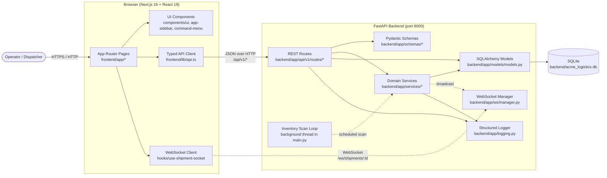
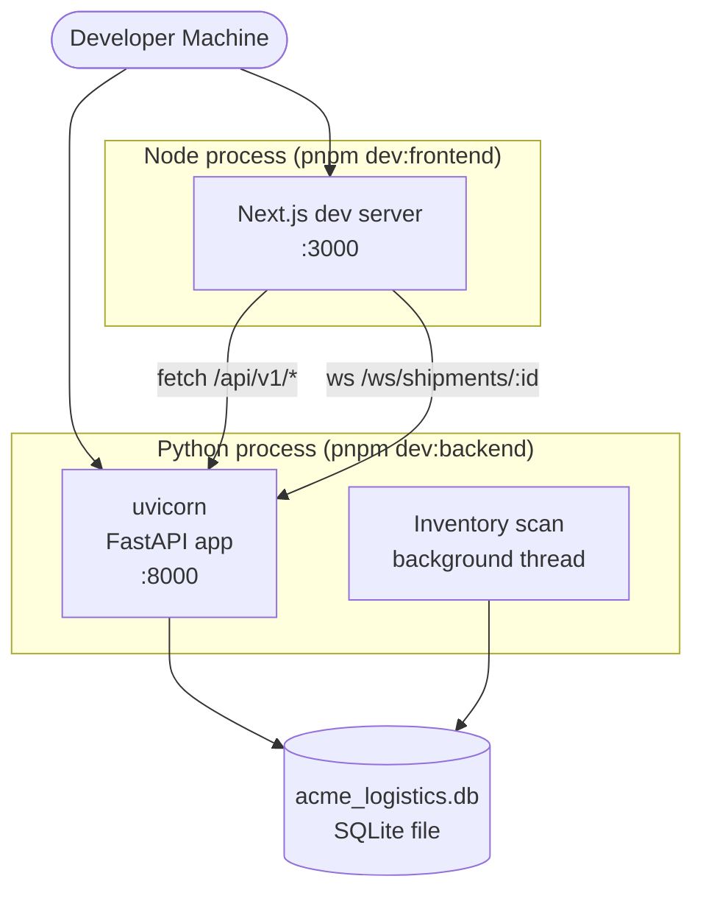

# System Overview

Acme Logistics is an enterprise logistics management platform built as a
pnpm-managed monorepo with a Python FastAPI backend and a Next.js / React
frontend. This document describes the high-level architecture, the major
components, and how they interact at runtime.

## High-Level Architecture

## Request Routing

- **Frontend origin**: `http://localhost:3000`
- **Backend origin**: `http://localhost:8000`
- **API prefix**: `/api/v1`
- **WebSocket path**: `/ws/shipments/{shipment_id}`
- **OpenAPI docs**: `http://localhost:8000/docs`

CORS is configured in `backend/main.py` to allow the Next.js dev origin
(`http://localhost:3000` and `http://127.0.0.1:3000`). Update that middleware
when adding new frontend origins.

## Technology Stack

### Frontend

| Concern | Library |
|---------|---------|
| Framework | Next.js 16 (App Router) |
| UI Runtime | React 19 |
| Styling | Tailwind CSS 4, shadcn/ui, Radix UI |
| Icons | Lucide |
| Charts | Recharts |
| Maps | Leaflet + react-leaflet |
| Theme | next-themes |
| Tests | Vitest + React Testing Library |
| Lint / Format | ESLint, Prettier |

### Backend

| Concern | Library |
|---------|---------|
| Framework | FastAPI + uvicorn |
| ORM | SQLAlchemy 2.0 (`mapped_column` style) |
| Validation | Pydantic v2 |
| Database | SQLite (file-based, `acme_logistics.db`) |
| Lint / Format | Ruff, Black |
| Tests | pytest |

### Tooling & CI

| Concern | Tool |
|---------|------|
| Monorepo | pnpm workspaces |
| Git hooks | Husky |
| Dependency health | Syncpack, Knip |
| Release | release-please |
| Dependency updates | Renovate |
| Secret scanning | Gitleaks (see `.gitleaks.toml`) |
| CI | GitHub Actions (`.github/workflows/`) |
| E2E | Playwright (`e2e/`, `playwright.config.ts`) |

## Deployment Topology (Local Dev)

- The backend runs as a single uvicorn process. A background thread periodically
  scans inventory for low-stock items (see `backend/main.py::inventory_scan_loop`).
- SQLite is embedded, so there is no separate database server in local dev.
  Resetting state is as simple as `pnpm db:reset`.
- Production deployment targets are documented in `docs/runbooks/` (API outage,
  DB issues, frontend deploy failure).

## Major Subsystems

| Subsystem | Location | Responsibility |
|-----------|----------|----------------|
| API Routes | `backend/app/api/v1/routes/` | HTTP endpoints for dashboard, customers, facilities, orders, shipments, inventory, vehicles, users, notifications, search, bulk, analytics, route planning, forecasting |
| Domain Services | `backend/app/services/` | Cross-route business logic such as `inventory_alerts.sync_low_stock_notification` |
| Persistence | `backend/app/db/database.py`, `backend/app/models/models.py` | SQLAlchemy engine, session factory, ORM models |
| Validation | `backend/app/schemas/` | Pydantic request/response DTOs |
| Realtime | `backend/app/ws/manager.py` | Connection registry and broadcast helpers for shipment updates |
| Background Jobs | `backend/main.py` (`inventory_scan_loop`) | Scheduled rescan of inventory for low-stock notifications |
| Frontend Pages | `frontend/app/` | Dashboard, orders, shipments, inventory, facilities, fleet, settings |
| Frontend API Client | `frontend/lib/api.ts` | Typed `fetch` wrapper with logging and error propagation |
| Seeding | `backend/seed.py` | Generates demo customers, facilities, orders, shipments, inventory, vehicles, users, notifications |

See [Service Dependencies](./service-dependencies.md) for the full internal and
external dependency inventory, and [Request Flows](./request-flows.md) for
sequence diagrams of key user journeys.
